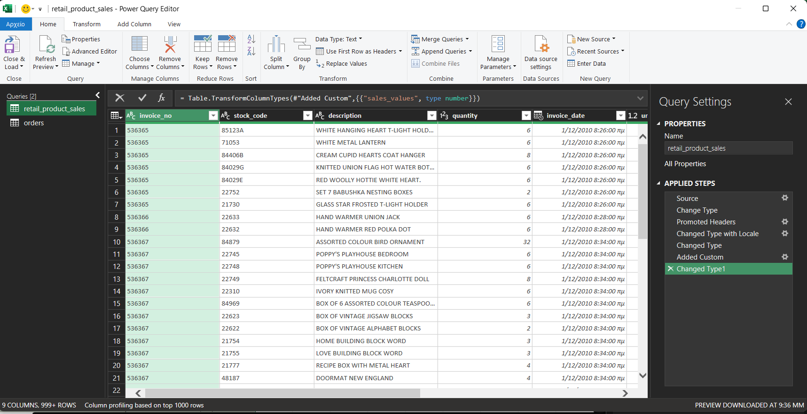
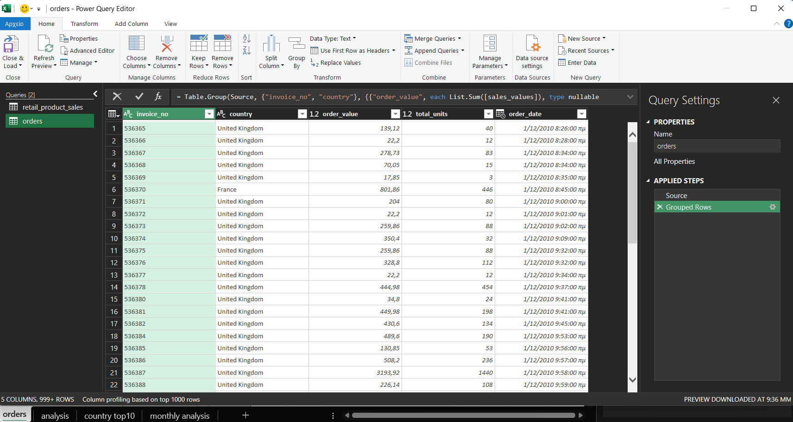
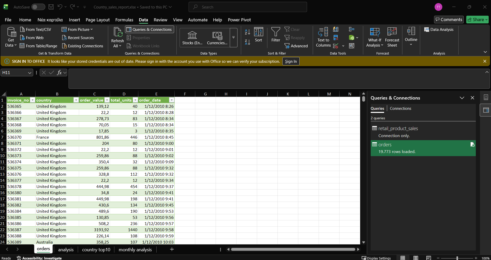
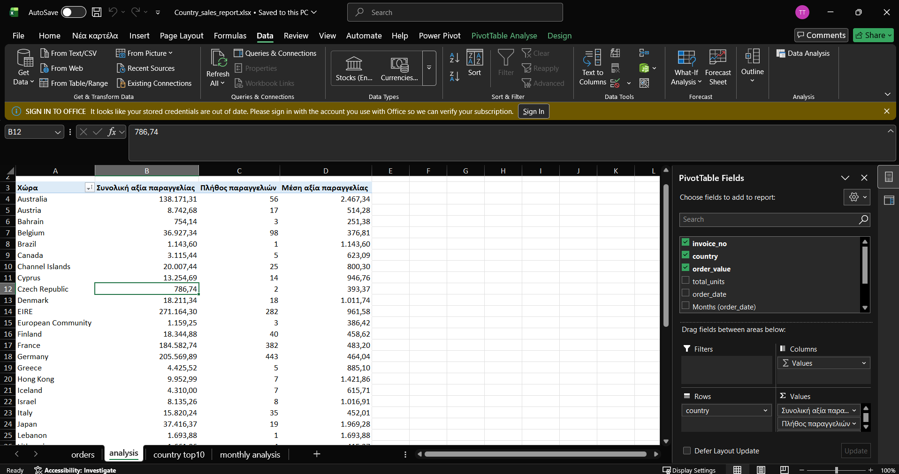
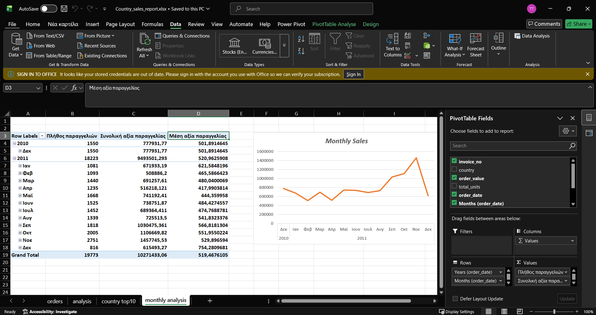
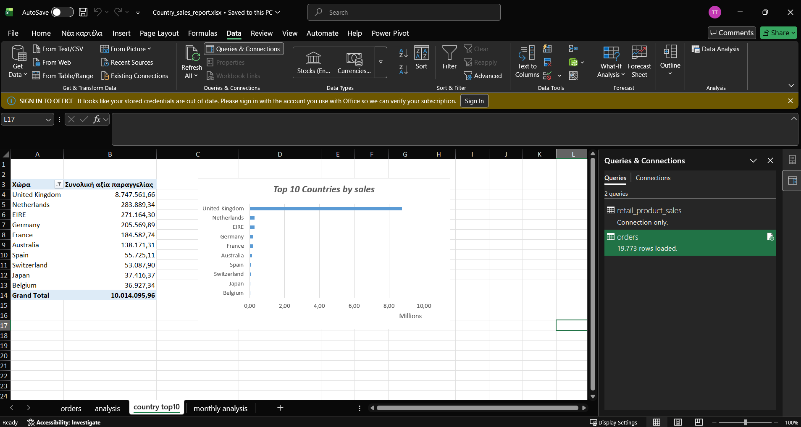

# excel-retail-sales-analysis
# Retail Sales Analysis with Excel

Εκπαιδευτικό project ανάλυσης λιανικών πωλήσεων με **Excel, Power Query, Pivot Tables και Pivot Charts**.

Στόχος ήταν να εξασκηθώ στη μετατροπή αναλυτικών συναλλαγών σε πίνακα παραγγελιών και στη δημιουργία αναφορών που απαντούν σε δύο ερωτήματα:

- Ποιες χώρες έχουν τη μεγαλύτερη συνολική αξία πωλήσεων;
- Πώς εξελίσσονται οι πωλήσεις και το πλήθος παραγγελιών ανά μήνα;

## Δεδομένα

Η αρχική πηγή είναι το [Online Retail — UCI Machine Learning Repository](https://archive.ics.uci.edu/dataset/352/online-retail), το οποίο περιλαμβάνει συναλλαγές ηλεκτρονικού καταστήματος με έδρα το Ηνωμένο Βασίλειο.

Για την παρούσα ανάλυση χρησιμοποίησα το ήδη προετοιμασμένο CSV `retail_product_sales.csv` από το προηγούμενο retail project μου. Τα αποτελέσματα αφορούν αυτή την επεξεργασμένη έκδοση των δεδομένων.

Η περίοδος ανάλυσης είναι **01/12/2010–09/12/2011**. Οι χρηματικές αξίες εκφράζονται σε **£**.

## Διαδικασία

### 1. Προετοιμασία στο Power Query

Εισήγαγα το CSV στο query `retail_product_sales`, χρησιμοποίησα την πρώτη γραμμή ως επικεφαλίδες και όρισα κατάλληλους τύπους δεδομένων. Χρησιμοποίησα μετατροπή με locale για τη σωστή ερμηνεία των τιμών.

Πρόσθεσα την υπολογισμένη στήλη:

`sales_values = quantity × unit_price`

Αυτή εκφράζει την αξία κάθε γραμμής προϊόντος. Μία παραγγελία μπορεί να περιλαμβάνει πολλές τέτοιες γραμμές.

### 2. Δημιουργία πίνακα παραγγελιών

Δημιούργησα το query `orders` με αναφορά στο `retail_product_sales` και ομαδοποίησα τις γραμμές με βάση τα `invoice_no` και `country`.

| Νέα στήλη | Υπολογισμός | Σκοπός |
|---|---|---|
| `order_value` | Sum της `sales_values` | Συνολική αξία παραγγελίας |
| `total_units` | Sum της `quantity` | Συνολικά τεμάχια παραγγελίας |
| `order_date` | Min της `invoice_date` | Πρώτη καταγεγραμμένη ημερομηνία και ώρα |

Η χώρα διατηρήθηκε ώστε να είναι διαθέσιμη στη γεωγραφική ανάλυση. Στα δεδομένα κάθε παραστατικό αντιστοιχεί σε μία χώρα, επομένως το αποτέλεσμα έχει **μία γραμμή ανά παραγγελία**.

Το `retail_product_sales` διατηρήθηκε ως **Connection Only**, ενώ το `orders` φορτώθηκε σε φύλλο Excel με **19.773 παραγγελίες**.

### 3. Ανάλυση με Pivot Tables

Δημιούργησα αναλύσεις ανά χώρα και ανά μήνα με:

- **Count του invoice_no:** πλήθος παραγγελιών.
- **Sum του order_value:** συνολική αξία πωλήσεων.
- **Average του order_value:** μέση αξία παραγγελίας.

Η συγκέντρωση σε επίπεδο παραγγελίας προηγείται των Pivot. Έτσι, το Count μετρά παραγγελίες και το Average υπολογίζει μέση αξία παραγγελίας, αντί για μέση αξία γραμμής προϊόντος.

Στη χρονική ανάλυση χρησιμοποίησα **μήνα και έτος**, ώστε οι ίδιοι μήνες διαφορετικών ετών να παραμένουν ξεχωριστοί.

### 4. Οπτικοποίηση

Δημιούργησα γράφημα γραμμής για την εξέλιξη των μηνιαίων πωλήσεων.

Σε αντίγραφο του Pivot ανά χώρα εφάρμοσα **Top 10 βάσει συνολικής αξίας** και φθίνουσα ταξινόμηση. Χρησιμοποίησα οριζόντιες μπάρες για τη σύγκριση των χωρών.

## Βασικά αποτελέσματα

| Δείκτης | Αποτέλεσμα |
|---|---:|
| Συνολική αξία πωλήσεων | £10.271.433,06 |
| Πλήθος παραγγελιών | 19.773 |
| Μέση αξία παραγγελίας | £519,47 |

- Ο **Νοέμβριος 2011** έχει τη μεγαλύτερη καταγεγραμμένη μηνιαία αξία πωλήσεων, **£1.457.745,53**, με **2.751 παραγγελίες**.
- Ο **Δεκέμβριος 2011 περιλαμβάνει δεδομένα μόνο έως τις 9/12**. Η χαμηλότερη αξία του δεν ερμηνεύεται ως πτώση έναντι πλήρων μηνών. Η συγκεκριμένη περίοδος επίσης δεν αρκεί για τεκμηρίωση επαναλαμβανόμενης ετήσιας εποχικότητας.

## Αρχεία και χρήση

- `Country_sales_report.xlsx`: queries, πίνακας παραγγελιών, Pivot Tables και γραφήματα.
- `images/`: εικόνες της διαδικασίας και των αποτελεσμάτων.

Το αρχικό CSV δεν περιλαμβάνεται λόγω μεγέθους. Το Excel περιέχει τα αποθηκευμένα αποτελέσματα και μπορεί να εξεταστεί χωρίς ανανέωση.

Για εκ νέου εκτέλεση των queries χρειάζεται το ίδιο CSV, ενημέρωση της διαδρομής στο βήμα **Source** του `retail_product_sales` και στη συνέχεια **Data → Refresh All**.

Το project δημιουργήθηκε για εξάσκηση στην προετοιμασία δεδομένων, στην επιλογή του κατάλληλου επιπέδου ανάλυσης και στην παρουσίαση ευρημάτων με Excel.
